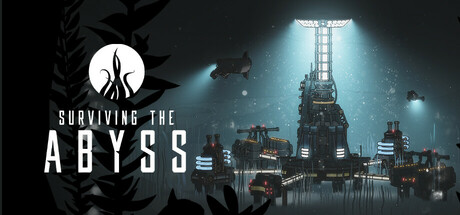

**Surviving the Abyss is the deep-sea city-builder survival game where you command an underwater research base at the bottom of the ocean. Manage oxygen, food, scientific research, and crew sanity against the crushing pressure and unknown ocean threats.**

---

## 📖 About

Surviving the Abyss is the deep-sea city-builder survival game where you command an underwater research base at the bottom of the ocean. Manage oxygen, food, scientific research, and crew sanity against the crushing pressure and unknown ocean threats.

## ⚠️ Problems Without Trainer

| Problem | Status |
|---------|--------|
| **Oxygen Management** — Running low on oxygen in any section causes immediate crew casualties | ✅ Solved |
| **Sanity System** — Isolated crew members suffer mental health decline affecting work performance | ✅ Solved |
| **Scientific Research** — Unlocking vital technologies requires completing specific research chains | ✅ Solved |
| **Pressure Events** — Hull breach events require instant repair response to prevent cascade failures | ✅ Solved |

## ✅ Solution

The **Surviving the Abyss Trainer** solves all these issues by giving you complete control over the game.

## 🎯 Full Feature List

- Unlimited Resources
- God Mode / Invincibility
- Instant Skill Cooldown
- One-Hit Kill
- Freeze Game Timer
- Unlock All Items & Achievements
- Custom Speed Multiplier
- Save State Anywhere

## 🚀 Quick Start

1. **Disable Windows Defender** temporarily (trainer may trigger false positive)
2. Download the trainer from the button above
3. Launch Surviving the Abyss
4. Run the trainer as Administrator
5. Activate desired cheats with hotkeys

## 💎 Free vs Paid

| Feature | Free | Pro |
|---------|------|-----|
| Basic God Mode | ✅ | ✅ |
| Unlimited Resources | ✅ | ✅ |
| All Advanced Cheats | ❌ | ✅ |
| Auto-Updates | ❌ | ✅ |
| Priority Support | ❌ | ✅ |

## 💻 Requirements

- Windows 10/11 (64-bit)
- Surviving the Abyss (any version)
- .NET Framework 4.8+
- DirectX 11+

## 🍎 macOS

macOS users can use our alternative tool:

## ⚖️ Legal

This trainer is for educational and single-player use only. Use responsibly.

---

